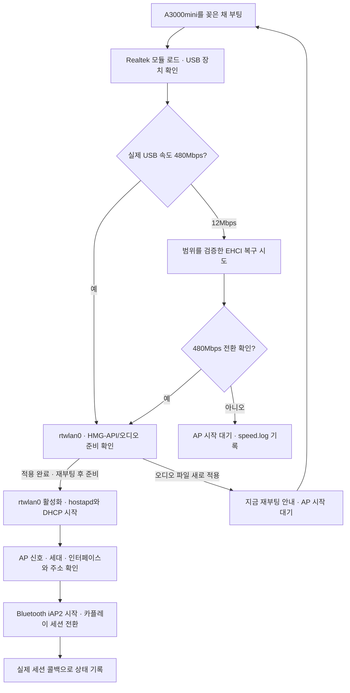

# NEMESIS RTL8812BU Gen5W

현대·기아 Gen5W 내비게이션에서 **RTL8812BU USB 무선랜의 부팅 인식과 AP 작동을 구현·검증하는 프로젝트**입니다. Korea Projection과 HMG-API를 포함한 완성 USB 설치 ZIP을 제공합니다. 차량에서 따로 빌드할 필요는 없습니다.

**[v0.1.23 USB 설치 ZIP 다운로드](https://github.com/Seikoz/nemesis-rtl8812bu-gen5w/releases/download/cn7npe-usb-bundle-v0.1.23/NEMESIS-CN7NPE-260902-Bundle-v0.1.23-USB.zip)** · [릴리스 안내](https://github.com/Seikoz/nemesis-rtl8812bu-gen5w/releases/tag/cn7npe-usb-bundle-v0.1.23) · [전체 변경 이력](CHANGELOG.md)

> **실차 시험용 패키지입니다.** v0.1.18 로그에서는 수동 재장착 전에 자동 480Mbps 전환과 드라이버 준비를 통과했습니다. 이후 HMG-API 설정 대기가 있었고, 카플레이 화면이 연결돼도 멜론 소리가 휴대폰에서 나오는 문제가 보고됐습니다. v0.1.19는 오디오 지원 파일 자동 적용을 수정하며, 재장착 없는 전체 부팅과 실제 음성 정상 동작은 실차 확인이 필요합니다.

[시험 대상](#프로젝트와-시험-대상) · [경고 사항](#경고-사항) · [패키지 구성](#패키지-구성) · [작동 원리](#작동-원리) · [설치 순서](#설치-및-업데이트-순서) · [상태 표시](#상태-표시-읽는-법) · [알려진 문제](#알려진-문제점과-제한-사항) · [미확인 사항](#미확인-사항) · [로그 수집](#문제-발생-시-로그-수집) · [검증 범위](#검증-범위) · [버전 이력](#버전별-변경-사항)

## 프로젝트와 시험 대상

프로젝트의 핵심은 **RTL8812BU 드라이버와 USB AP의 실제 작동**입니다. 무선 카플레이는 USB 인식부터 AP·Bluetooth·iAP2·카플레이 세션까지 이어지는 검증 대상입니다.

| 항목 | 현재 시험 기준 |
| --- | --- |
| 차량 | 2024년식 아반떼 N 페이스리프트 |
| 펌웨어 | `CN7NPE.KOR.S5W_M.V039.001.260902` — 로그에는 `CN7NPE.KOR.0000.V039.001.260902`로도 표시 |
| 플랫폼 / 커널 | TCC803x / `3.18.24-tcc` |
| 무선랜 | ipTIME A3000mini, USB ID `0bda:b812` |
| 네트워크 인터페이스 | `rtwlan0` |
| 설치 관리자 | NEMESIS Manager 1.16.7 이상, 이미 설치된 상태 |

다른 차량·지역·펌웨어·동글의 호환성은 확인하지 않았습니다. 같은 RTL8812BU 칩셋이라는 이유만으로 동일하게 동작한다고 판단하지 않습니다. `CN7PE` 지도와 `CN7NPE` 지도도 구분합니다.

## 경고 사항

- **주차 상태에서 설치·재부팅·연결 시험을 진행하세요.** 시스템 훅과 커널 모듈을 사용하는 시험판이며, 내비게이션 재부팅이나 기능 오류가 생길 수 있습니다.
- **기존 NEMESIS가 필요합니다.** 이 ZIP은 NEMESIS 자체나 차량 순정 펌웨어를 설치하는 패키지가 아닙니다.
- **공식 무선 모드 원본을 추가로 덮어쓰지 마세요.** 합본은 `rtwlan0`용 이식판과 기존 합본 작성자 서명을 사용합니다. 공식 원본은 작성자 서명·버전·기본 핫스폿 경로가 다릅니다.
- **실제 USB 480Mbps 확인 전에는 AP 시작을 대기합니다.** 12/480Mbps는 USB 버스 속도이며 Wi-Fi 링크 속도나 실제 전송 속도가 아닙니다.
- **AP 준비나 연결 표시만으로 카플레이 성공을 판단하지 마세요.** 화면·음악·통화가 실제로 유지되는지도 확인해야 합니다.
- **이전 ZIP 보존과 자동 다운그레이드는 별개입니다.** 이전 버전 ZIP을 설치하는 것만으로 본체·모드·설정이 모두 되돌아간다고 가정하지 마세요. 제거할 때는 Korea Projection을 먼저 제거하고 [설치·제거 안내](bundle/INSTALL-KO.md)를 확인하세요.
- **필요한 로그는 다음 재부팅 전에 저장하세요.** 공유 전에는 휴대폰 이름·주소 등 개인 정보가 남아 있는지 확인하세요.

## 패키지 구성

| 구성 요소 / 표시 이름 | v0.1.23 버전 | 역할 |
| --- | --- | --- |
| Korea Projection CN7NPE BETA | **1.7.4.28** | 설치 의존성, 오디오 파일 자동 적용, USB AP·DHCP 운영, 상태 표시·제보 수집 |
| Realtek Wi-Fi Driver | **1.1.17** | RTL8812BU 커널 모듈 로드, 동글 바인딩, 부팅 감시와 제한된 USB 고속 복구 |
| HMG-API 본체 | **1.1.0-rc.7** / NEMESIS 패키지 **1.0.99.7** | 시스템 훅·차량 지도·모드 설치 및 적용 |
| HMG-API Wireless Mode | **2.4.14** | HMG-API 안의 무선 모드. 공식 **2.2.0-rc.8** 기반 USB 이식판, AP 대기·카플레이 세션·iAP2 처리 |

**2.4.14는 이 프로젝트의 로컬 업데이트 버전**입니다. 같은 작성자로 서명한 공식 rc.8 기반 이식판이며, v0.1.23에서 iAP2 전환과 관련 로그를 수정했습니다. HMG-API 본체는 공식 rc.7 ZIP을 사용합니다.

**Korea Projection CN7NPE BETA**는 기존 **Korea Projection CN7NPE USB Test**의 새 이름입니다. **HMG-API Wireless Mode (USB)**도 **HMG-API Wireless Mode**로 줄였습니다. Realtek Wi-Fi Driver 1.1.17과 HMG-API 본체는 v0.1.20과 같습니다. 기존 **Realtek RTL8812BU USB Driver**는 **Realtek Wi-Fi Driver**로, HMG-API 모드 목록의 **RTL8812BU USB Wireless**는 **HMG-API Wireless Mode**로 표시합니다. 후자는 HMG-API 본체와 별개인 모드입니다. 패키지 ID·모드 ID·작성자 서명을 유지하므로 먼저 제거할 필요 없이 Korea Projection 하나를 Update합니다.

USB에 풀었을 때의 기본 구조는 다음과 같습니다.

```text
USB/
├── NEMESIS.data
├── INSTALL-KO.md
├── licenses/
└── packages/
    ├── hmgapi.zip
    ├── korea.projection.zip
    └── realtek.88x2bu.zip
```

`packages/` 안의 ZIP 세 개는 압축 상태로 둡니다. 무선 모드 ZIP과 실행 도구는 Korea Projection 패키지에 포함돼 있으므로 따로 설치할 파일을 찾을 필요가 없습니다.

## 작동 원리

### 설치 의존성과 모드 적용

USB Package Store에서 **Korea Projection 하나를 선택**합니다. NEMESIS가 의존성을 확인해 필요한 HMG-API와 Realtek을 먼저 설치/업데이트합니다. 이후 Korea Projection이 포함된 무선 모드를 설치하거나 갱신하고 적용합니다. 본체 런타임과 무선 모드는 재부팅 후 새 코드가 로드됩니다.

v0.1.19부터 **이미 설치된 동일 버전의 무선 모드도 확인**합니다. rc.7의 정상 안내 문구를 오류로 취급하던 필터를 수정했습니다. 새 오디오 지원 라이브러리의 적용이 남아 있으면, 합본 소유·고정 여부·전체 설치 파일 해시와 현재 적용 계획을 확인하고 AP 시작 전에 적용합니다. 다른 모드 변경·문제·되돌리기·알 수 없는 형식은 자동 적용하지 않습니다. **적용 완료 안내가 나오면 지금 재부팅을 눌러야 합니다.** 같은 부팅에서는 다시 적용하거나 AP를 시작하지 않으며 자동 재부팅도 하지 않습니다.

### USB 인식과 AP 시작

v0.1.21 실차 로그에서 수동 조작 없이 USB 480Mbps와 rtwlan0이 준비됐고, AP는 부팅 약 148초 뒤 켜졌습니다. v0.1.22는 기존 설정의 적용 계획·관리 파일 상태·지도 확인 기록이 일치하면 120초 복구 대기를 생략합니다. 확인에 실패하거나 설정 변경이 필요하면 기존 대기 절차를 따릅니다. `usb-boot-setup.log`와 AP 로그로 경로를 확인할 수 있습니다.



동글이 외부 OHCI에서 12Mbps로 잡히면 한 부팅에서 **EHCI 소유권 반환 1회**, 계속 실패하면 **외부 OHCI/EHCI 재초기화 1회**를 요청합니다. 직결 A3000mini 한 대·단일 포트·유일한 외부 컨트롤러 쌍·비어 있는 EHCI·내려간 인터페이스가 확인된 경우에만 진행합니다. 내부 `tcc-ehci`, 허브, 다른 장치가 연결된 루트와 활성 인터페이스는 복구 대상에서 제외합니다.

재초기화에서는 OHCI를 해제한 채 EHCI 아래 A3000mini의 480Mbps·구성 완료를 최대 12초 확인한 뒤 OHCI 복원을 시도합니다. Korea Projection의 NEMESIS 드라이버 호출 제한은 90초입니다. **호스트 재등록 성공은 실제 480Mbps 성공과 다르며, 물리 VBUS 전원 차단이나 보드 PHY 초기화를 보장하지 않습니다.**

### 무선 세션과 방화벽

v0.1.23은 무선 출처와 현재 AP가 확인된 transport 0 세션에서 SPP 종료 뒤 첫 CarPlay 채널 데이터를 최대 1.2초 기다립니다. 첫 데이터로 전환이 시작되거나 시간 만료 시 차량 쪽에서 전환을 요청합니다. 첫 수신과 첫 네이티브 송신 결과는 `USB_CP_HANDOVER`에서 확인합니다.

무선 모드는 AP 준비 신호, 유효한 AP 세대, UP 상태의 `rtwlan0`과 `192.168.43.1`을 확인한 뒤 Bluetooth iAP2를 시작합니다. AP 대기는 최대 약 180초이며 Bluetooth 해제·모드 비활성화·유선 연결·세션 교체 시 취소합니다.

USB iAP2가 없고 이 브리지의 Bluetooth 출처와 같은 AP가 확인된 세션에 한해 `transport=0`도 무선 세션으로 인정합니다. SPP가 끝나면 카플레이 채널로 iAP2를 이관하며, 이전 세션이나 AP에 속한 예약 작업과 전송을 구분합니다. `transport=0`을 모든 차량의 무선 연결로 해석하는 방식은 아닙니다.

방화벽 정책은 `rtwlan0`의 차량 AP IPv4 대역 `192.168.43.0/24`와 IPv6 링크 로컬 대역을 중심으로 적용합니다. 기존 TCP/UDP에 동적 TCP 포트와 IPv6 UDP 6031을 포함하며, AA TCP 40515 규칙도 USB 대역으로 제한합니다. 실제 적용 규칙·순서·카운터는 제보 로그로 확인합니다.

## 설치 및 업데이트 순서

1. **다운로드·압축 해제:** 위의 v0.1.23 ZIP을 FAT32 USB 메모리 최상위에 풉니다. `NEMESIS.data`와 `packages/`가 USB 루트에 있는지 확인합니다.
2. **Korea Projection 선택:** 주차 상태에서 설치 USB를 내비게이션 데이터 USB 포트에 꽂습니다. **NEMESIS → Package Store → USB → Korea Projection CN7NPE BETA → Install / Update**를 선택합니다.
3. **의존성 설치 확인:** 설치 계획을 확인하고 진행합니다. 필요한 HMG-API rc.7과 Realtek Wi-Fi Driver 1.1.17은 같은 USB에서 먼저 설치/업데이트됩니다. 이미 조건을 충족하면 다시 설치하지 않을 수 있습니다.
4. **동글로 교체:** 설치가 끝나면 설치 USB를 빼고 A3000mini를 꽂아 둡니다.
5. **OS 재부팅:** **NEMESIS → My Packages → Korea Projection → Launch**로 상태 화면을 열고 **지금 재부팅**을 누릅니다. 이 버튼은 `sync` 후 시스템 `reboot`를 요청합니다.
6. **본체·모드 버전 확인:** HMG-API 앱에서 **1.1.0-rc.7 / Hooks on(훅 활성)**, **HMG-API Wireless Mode 2.4.14**를 확인합니다. 모드 업데이트·적용 또는 **오디오 지원 파일 자동 적용** 안내가 나오면 완료 후 **한 번 더 지금 재부팅**을 누릅니다. 자동 적용 보류가 나오면 HMG-API 변경 사항과 제보 로그를 확인합니다.
7. **자동 부팅 시험:** A3000mini를 꽂은 채 약 2분 기다립니다. 첫 시험에는 동글을 재장착하거나 Realtek Launch를 누르지 않습니다.
8. **연결 시험:** `USB Wi-Fi AP ready (rtwlan0)`를 확인한 뒤 iPhone의 Wi-Fi·Bluetooth를 켜고 내비게이션과 페어링해 CarPlay를 허용합니다. 화면·음악·통화가 유지되는지 확인합니다.

HMG-API가 응답하지 않거나 `Operation failed`가 나오면 현재 설치 버전과 실패 문구를 기록하고 [상세 설치·업데이트 안내](bundle/INSTALL-KO.md)를 확인하세요. 오류 문구만으로 원인을 단정하거나 본체·모드를 반복 제거하지 마세요.

## 상태 표시 읽는 법

| 관측한 상태 | 확인된 것 | 추가 확인할 것 |
| --- | --- | --- |
| 드라이버 로드됨 | 커널 모듈 로드 | 동글 바인딩·실제 USB 속도·인터페이스 생성 |
| USB 480Mbps | USB 고속 열거 | AP 활성화와 Wi-Fi 접속 |
| `rtwlan0` 존재 | 네트워크 인터페이스 생성 | 480Mbps, UP 상태, AP·DHCP 시작 |
| AP ready | AP 준비 조건 충족 | iPhone 접속과 카플레이 세션 시작 |
| Wi-Fi 단말 수 증가 | hostapd 인증 또는 Realtek 연결 테이블에서 접속 관측 | 카플레이 프로토콜·화면·음성 |
| 세션 연결됨 / `started` | 실제 무선 세션 시작 콜백 및 부팅·프로세스·AP 세대 검증 | 화면·음악·통화의 정상 유지 |
| 단말 수 확인 불가 | 조회 경로에서 접속 수를 읽지 못함 | 미접속 0대와 구분해 로그 확인 |

상태는 보통 약 30초 점검 주기에 갱신됩니다. 제보 USB로 바꾸려고 동글을 빼면 현재 상태가 AP lost/미연결로 바뀔 수 있으므로, 같은 부팅에서 저장된 직전 기록을 함께 봅니다.

## 알려진 문제점과 제한 사항

과거 실차 관측과 현재 코드의 대응을 구분합니다. 수정 코드가 있다는 사실이 최신 버전에서 해결됐다는 실차 확인을 뜻하지는 않습니다.

| 항목 | 관측·제한 | 현재 대응 또는 확인 방법 |
| --- | --- | --- |
| USB 12Mbps 인식 | 과거 실패가 있었으나 v0.1.18 로그는 재장착 전 자동 480Mbps 전환을 확인 | 기존 EHCI 복구 유지. 최신 시험도 `speed.log`의 실제 `speed_after=480`으로 판단 |
| 부팅 후 대기 / 재장착 | v0.1.18은 17:51:50 드라이버 준비 통과 뒤 HMG-API 설정 대기, 수동 재장착은 17:53 | 재장착 필수 여부는 이 시험으로 확정 불가. 새 `USB readiness passed` 로그로 USB 대기와 설정 대기를 구분 |
| 멜론 소리가 휴대폰에서 나옴 | 연결 화면·세션 시작 이후 증상. rc.7 적용 필터 오류와 오디오 파일 대기 확인 | v0.1.19에서 자동 적용·재부팅 안내. 무음 해소 여부와 iAP2 실패·오디오 경로의 관계는 미확인 |
| 연결 창만 표시 / 연결·끊김 반복 | 과거 AP 준비·세션 시작 뒤에도 연결 실패나 반복 종료가 보고됨 | AP·접속 단말·실제 세션·화면/음성을 분리해 관측. 최신 무선 모드 이식 결과는 실차 확인 필요 |
| 인터페이스 UP / hostapd 오류 | 과거 `Operation not permitted`와 AP 시작 실패가 보고됨 | UP 전후 커널 로그·hostapd 권한/종료 로그 수집. 재발 원인을 오류 문구만으로 단정하지 않음 |
| 외부 호스트 복구 범위 | 허브·여러 후보·다른 장치·활성 인터페이스·제어 파일 부재 시 복구를 거부할 수 있음 | `speed.log`의 거부 사유·복원 결과 확인. 물리 전원 재인가와 같은 동작으로 간주하지 않음 |
| 351개 차량 지도 | 공식 rc.8의 신규 훅 8개를 선언하면 모드 전체가 거부될 수 있음 | 이식판은 호환되는 41개 선언을 사용. 신규 다중 폰 제어·US/Canada 팝업·AA 주차 소비자는 등록하지 않음 |
| 카플레이 주차·복귀 | 기존 351개 지도에는 필요한 종료·재광고 점도 없음 | 해당 점이 매핑된 경우에만 켜지는 구조. 현재 차량 지도에서 활성화됐다고 볼 수 없음 |
| 이전 한국판 전용 옵션 | `tbt_fit`·별표 팝업 건너뛰기는 새 상위 소스에 이식하지 않음 | 저장된 설정이 남아 있어도 새 모드의 같은 기능으로 해석하지 않음 |

상위 소스·서명·지도별 세부 검토는 [rc.7 / rc.8 USB 호환성 문서](docs/compatibility-rc7-rc8-usb.md)를 참고하세요.

재장착 시각과 USB·HMG-API·iAP2 단계를 나눈 [최근 부팅/오디오 로그 분석](docs/boot-audio-log-2026-11-20.md)도 기록했습니다. 로그의 native iAP2 반환값 19의 정확한 뜻은 확인되지 않았습니다. Realtek의 별도 `awk: not found` 진단 제한은 이번 Korea Projection 수정에 포함하지 않았습니다.

## 미확인 사항

- v0.1.19 지원 파일 적용·재부팅 후 A3000mini를 꽂은 채 **수동 조작 없이 AP 준비까지 도달하는지**. v0.1.18의 재장착 전 USB 480Mbps·드라이버 준비 통과와는 별도 확인 사항입니다.
- 카플레이의 장시간 연결, 화면·음악·Siri·통화, 주행 안내 및 계기판 표시가 안정적으로 유지되는지.
- A3000mini 프리징의 재현 조건과 원인, USB·무선 링크의 실제 처리량. USB 12/480Mbps 표시는 처리량 측정값이 아닙니다.
- 차량 순정 네이티브 라이브러리에 대한 새 무선 모드 레시피의 실제 적용·음성 동작. 해당 사유 라이브러리가 필요한 오프라인 검사는 파일 부재로 건너뛴 항목이 있습니다.
- 최신 본체·로컬 차량 지도의 실차 호환성과 지도 의존 기능, Android Auto의 실제 연결·유지 동작.
- 다른 차량·펌웨어·동글 조합 및 이전 버전으로의 전체 복원 결과.

## 문제 발생 시 로그 수집

### 부팅과 재장착을 비교하는 순서

1. A3000mini를 꽂은 채 재부팅하고 약 2분 기다린 뒤 상태와 시간을 기록합니다.
2. 실패하면 같은 부팅에서 동글을 한 번 뺐다 꽂고 **분리·재장착 시각**을 각각 기록합니다. 필요하면 Realtek Launch를 한 번 누르고 그 시각도 기록합니다.
3. **다시 재부팅하기 전에** 동글을 제보 USB 메모리로 바꿉니다.
4. **NEMESIS → My Packages → Korea Projection → Launch → 제보 파일 만들기**를 실행합니다.
5. USB의 `KoreaProjection-report/3-log.txt`와 생성된 `1-report.md`, `2-car-report.json`을 함께 보냅니다. Realtek `speed.log`, `boot.log`, `preload.log`, `launch.log`도 확보할 수 있으면 첨부합니다.

제보할 때 합본·본체·무선 모드 버전, 처음부터 동글을 꽂았는지, 실제 화면·음성 증상, 수동 조작 시각을 함께 적어주세요. USB 장치 번호 변경에는 자동 복구에 따른 재열거도 포함되므로 번호 변경만으로 수동 재장착을 판단하지 않습니다.

### 로그에서 보는 항목

| 로그·항목 | 확인 목적 |
| --- | --- |
| `speed.log` | EHCI 소유권·호스트 재초기화 단계, 열거 준비/시간 초과, USB 버스 변경 전후 커널 기록, 실제 480Mbps 확인 |
| `boot.log` / `preload.log` / `launch.log` | 부팅 자동 실행, 모듈/동글 바인딩, 수동 Launch 결과 |
| `usb-ap-up-boot.log` / `usb-ap-up-replug.log` | 첫 USB와 재열거 후 인터페이스 UP, 실제 속도·전후 커널 로그 |
| `usb-hostapd-permissions-*.log` / `usb-hostapd-logcat-*.log` | hostapd의 UID·권한·SELinux 상태, 종료 코드·실패 순간 로그 |
| `usb-carplay-events.log` / `usb-cp-capture.log` | 세션 생성·시작·종료와 수집 실패 여부 |
| `usb-audio-apply.log` / `usb-mod-files-check.log` / `mod-apply.txt` | 같은 버전의 오디오 지원 파일 적용 여부, 설치 파일 일치, 보류·실패·재부팅 대기 |
| `usb-connection-first.log` / `usb-connection-latest.log` | 실제 방화벽 규칙·순서·카운터, mDNS·TCP 관측 |

제보 파일은 위 진단 내용을 모아 줍니다. 파일이 없거나 0KB라면 화면의 복사 완료 문구만으로 수집 성공으로 판단하지 말고, 위 제보 경로로 다시 수집해 내용이 들어 있는지 확인하세요. mDNS 응답 없음이나 방화벽 카운터 하나만으로 실패 원인을 단정하지 않습니다.

HMG-API rc.7에서는 **Logs → Record a problem**을 시작하고 증상을 재현한 뒤 종료하는 방법도 사용할 수 있습니다. USB 인식 분석에는 Korea Projection 제보와 Realtek 로그가 함께 필요합니다.

## 검증 범위

### v0.1.23 iAP2 전환 검사

- [Android API 19 빌드 및 회귀 검사](https://github.com/Seikoz/nemesis-rtl8812bu-gen5w/actions/runs/44740466978) 통과. Linux 검사 36개, 실제 수정된 전환 코드, rc.7 설치 계획·적용·복원과 지도 호환을 확인했습니다.
- 기존 작성자 서명·부팅 대기 코드·오디오 지원 파일 보존, 완성 ZIP의 셸 문법 29개와 재현 빌드를 확인했습니다. 실제 iAP2 식별과 차량 음악 출력은 차량에서 측정해야 합니다.

### v0.1.22 부팅 대기 검사

- [Linux 회귀 36개](https://github.com/Seikoz/nemesis-rtl8812bu-gen5w/actions/runs/44733065568) 통과. 적용·권한 복구가 필요 없는 기존 설치의 대기 생략과, 설정 미완료·변경 대기·검증 실패 시 기존 절차를 확인했습니다.
- 완성 ZIP의 셸 29개 문법, 기존 오디오 적용 뒤의 실행 순서, 동일 입력 재빌드 및 본체·드라이버·무선 모드 ZIP이 동일함을 확인했습니다. 실제 단축 시간은 차량에서 측정합니다.

### v0.1.21에서 확인한 항목

- [기존 회귀 33개](https://github.com/Seikoz/nemesis-rtl8812bu-gen5w/actions/runs/44717133899) 통과. 새 이름·업데이트 버전·의존성·기존 설치 허용 범위와 같은 작성자 서명을 확인했습니다.
- 이전 v0.1.20과 대조해 본체·드라이버 ZIP 보존과 무선 모드의 표시 이름·버전·서명 정보만 변경됐음을 확인했습니다. 기존 USB Test와 새 BETA 이름의 업데이트 허용 범위도 확인했습니다. 커널 모듈·드라이버 셸·훅·오디오 파일·방화벽 설정은 동일합니다. 완성 ZIP의 셸 29개 문법과 동일 입력 재빌드도 확인했습니다.

### v0.1.19 기반 자동 적용 검증

- [Linux 회귀 33개](https://github.com/Seikoz/nemesis-rtl8812bu-gen5w/actions/runs/44713724656): rc.7 계획 형식, 같은 버전의 자동 적용·재부팅 대기·다음 부팅 무변경, 다른 모드/수정/고정/실패/활성 AP 거부, BusyBox 전용 세션 조회 통과.
- 완성 ZIP의 29개 셸 문법, 공식 본체 파일/지도 493개 해시, 의존성·업데이트 조건, 서명·41개 훅 지도 호환, 이전 rc.4 업데이트의 상태 보존 확인.
- 전체 서명 모드 파일의 체크섬 목록과 AP 이전 적용/재부팅 게이트, 제보 로그 포함, 본체·Realtek·무선 모드·도구 보존, 동일 입력 재빌드의 바이트 동일성 확인.

### v0.1.18 기반 구성 검증

- [공식 SDK·회귀 24개·실제 수정 메서드/패치 엔진·351개 지도 호환 검사와 Android API 19 빌드](https://github.com/Seikoz/nemesis-rtl8812bu-gen5w/actions/runs/44701743445) 통과. 상위 CpTx/재이관 91개와 경로 안내 60개 검사 포함.
- 실제 rc.7 엔진의 CN7NPE KOR·SDIO 없는 모의 환경에서 설치 계획·적용·재적용·바이트 동일 복원과 USB 규칙 생성 확인.
- 29개 셸 문법, 공식 본체 내부 파일/지도 493개 해시, 무선 모드 작성자·서명·업데이트 조건, 이전 rc.4 업데이트의 상태 보존 경로 확인.
- 기존 Realtek/도구 보존, 동일 입력으로 만든 최종 ZIP의 바이트 동일성, 게시된 공개 다운로드와 SHA-256 확인.

위 검사는 소스·빌드·모의 환경·배포 파일 검증입니다. 실제 차량의 RF 성능·USB PHY·화면·음성 정상 동작을 대신 검증한 결과가 아닙니다.

**v0.1.23 USB ZIP SHA-256**

```text
16fe8ba4f483e71ecdff1bb0e12f203d83a98e7619ca0163b14e5afbda8134a4
```

<details>
<summary>이전 버전 배포 검증 기록</summary>

### v0.1.17 배포 검증

- [실제 C 코드의 EHCI 버스 재번호화·지연 준비·미구성/다른 장치·시간 초과·실패/신호 복원 검사, 24개 회귀 검사와 Android API 19 빌드](https://github.com/Seikoz/nemesis-rtl8812bu-gen5w/actions/runs/44680540924)를 통과했습니다.
- 29개 셸 문법, 새 드라이버 의존성·90초 호출 제한·모드 서명, 기존 커널/카플레이 모드/본체 보존과 동일 입력 재빌드를 확인했습니다. 차량에서 실제 480Mbps 전환은 확인이 필요합니다.
- USB ZIP SHA-256: `773ebcc1e222caddbe4497b45fa1777a7ad6f5918c0533b4f8e62c0f52dddab4`

### v0.1.16 배포 검증

- [실제 C 코드의 외부 호스트 재초기화 모의 검사·기존 EHCI 검사·23개 회귀 검사와 Android API 19 빌드](https://github.com/Seikoz/nemesis-rtl8812bu-gen5w/actions/runs/44677378486)를 통과했습니다. 해제/등록 효과와 실패·SIGTERM을 모의해 순서·내부 호스트 보존·복원을 확인했습니다.
- 29개 셸 문법, 새 의존성·helper ELF·모드 서명, 기존 커널/카플레이 모드/본체 보존과 동일 입력 재빌드를 확인했습니다. 실차 480Mbps 자동 전환은 확인이 필요합니다.
- USB ZIP SHA-256: `74022f1af7b88e1a6130ab4e4417afeb30e3805505375511a410acc301424e78`

### v0.1.15 배포 검증

- [Linux의 실행 비트 손실 재현·22개 회귀 검사·기존 EHCI 범위 검사와 Android API 19 도구 빌드](https://github.com/Seikoz/nemesis-rtl8812bu-gen5w/actions/runs/44668325705)를 통과했습니다.
- 29개 셸 문법, 새 드라이버 의존성, 모드 서명과 기존 커널/실행 파일/카플레이 모드 보존 및 동일 입력 재빌드를 확인했습니다. 실차의 USB 480Mbps 복구와 Wi-Fi 처리량은 아직 확인되지 않았습니다.
- USB ZIP SHA-256: `db9b9339939a9e560b81da5f1f1a1f1c2679641ffce496cdbecae7d7dbee78bb`

### v0.1.14 배포 검증

- [실제 수정 메서드의 끊김 재현·이관·세션 격리 검사와 Android API 19 빌드](https://github.com/Seikoz/nemesis-rtl8812bu-gen5w/actions/runs/44665053112)를 통과했습니다. 16개 회귀 검사, 기존 AP 대기 검사와 원래 transport 값을 보존하는 상태 갱신 검사도 포함합니다.
- 중첩 ZIP·29개 셸 문법·동일 작성자 서명, 2.4.6~2.4.10 업데이트/재설치 조건, 기존 드라이버·본체·네트워크 정책 보존을 확인했습니다. 동일 입력 재빌드의 파일 내용도 일치합니다. 실차의 연결 지속 여부는 확인이 필요합니다.
- USB ZIP SHA-256: `ddac046fe0a26230b1a5548a44194b83d995f133ab7f6fc2c2adf2f6a25ad1f1`

### v0.1.13 배포 검증 기록

- [회귀 검사·세션 콜백·Android 훅 빌드](https://github.com/Seikoz/nemesis-rtl8812bu-gen5w/actions/runs/44536318095), [mDNS 응답 해석 검사·ARMv7 도구 빌드](https://github.com/Seikoz/nemesis-rtl8812bu-gen5w/actions/runs/44535807005)를 통과했습니다.
- 중첩 패키지·29개 셸 문법·모드 서명·드라이버/본체 보존과 동일 입력 재빌드를 확인했습니다. 차량에서의 실제 방화벽 통과·카플레이 동작 확인은 남아 있습니다.
- USB ZIP SHA-256: `340087b19afb6daaea24699776a1ebc80eed468da0ea121f5377129ab1b79f5c`

</details>

## 버전별 변경 사항

| 합본 버전 | 변경 사항 |
| --- | --- |
| v0.1.23 | 확인된 transport 0 무선 세션의 SPP 종료 뒤 최대 1.2초 첫 수신 대기, 첫 수신·네이티브 송신 반환값 기록 |
| v0.1.22 | 기존 설정이 검증된 부팅에서 120초 권한 복구 대기 생략, 부팅 기록 추가 |
| v0.1.21 | HMG-API Wireless Mode / Korea Projection CN7NPE BETA로 이름 확정, 기존 USB Test·BETA 이름의 업데이트 호환 유지 |
| v0.1.20 | 표시 이름을 Realtek Wi-Fi Driver / HMG-API Wireless Mode (USB)로 구분. 기존 설치 갱신용 버전 증가와 동일 ID·작성자 유지, 실행 코드 보존 |
| v0.1.19 | rc.7 자동 적용 필터 수정, 같은 2.4.11의 오디오 지원 파일 확인·적용·재부팅 대기, USB/HMG 설정 단계 로그, BusyBox 세션 조회 수정 |
| v0.1.18 | HMG-API rc.7 + 공식 무선 rc.8 기반 USB 이식판 2.4.11, 351개 지도 호환·AP 대기·세션/이관·방화벽 검증, Realtek 1.1.16 유지 |
| v0.1.17 | EHCI 480Mbps 구성 완료 대기 후 OHCI 복원, 드라이버 호출 제한 20→90초, USB 버스 재번호화 이후의 커널 로그 수집 |
| v0.1.16 | 소유권 반환 후 12Mbps가 유지되면 외부 OHCI/EHCI를 EHCI 우선 순서로 재초기화, 대상 범위·복원·실제 480 확인 |
| v0.1.15 | USB 12→480Mbps 복구 도구의 실행 권한 누락 수정, 준비 실패 시 시도 예산 보존, 조회·진단 도구 실행 권한 복구 |
| v0.1.14 | 확인된 USB-AP Bluetooth 세션의 transport=0 판정, SPP 종료 후 iAP2 이관, 이전 세션의 예약 작업·전송 차단 |
| v0.1.13 | IPv6 UDP 6031 허용, 실제 방화벽 규칙·순서·카운터와 mDNS 진단, 실제 카플레이 세션 기준 연결 표시 |
| v0.1.12 | USB AP 대역의 동적 TCP 허용, 현재 접속 단말 수·확인 불가 표시, 기존 설치의 포트 정책 자동 적용 |
| v0.1.11 | AP 준비 전에 Bluetooth iAP2가 시작되는 순서 수정, 준비 후 자동 진행, 끊긴 연결의 대기 취소 |
| v0.1.10 | 부팅 시 A3000mini의 외부 포트를 EHCI로 되돌리는 복구 추가, 실제 USB 480Mbps를 확인한 뒤 AP 시작 |
| v0.1.9 | 분리된 네트워크 장치 등록 정리, 재장착 시 AP·DHCP 재시작, 첫 USB 기록 저장 수정, USB 속도·단말 접속 로그 추가 |
| v0.1.8 | Realtek 절전 옵션 비활성화, HALMAC 단계별 실패 로그 추가, `printf` 미지원 오류 수정, 인터페이스 UP 성공 뒤 AP 시작 |
| v0.1.7 | 칩 초기화 실패 로그와 부팅·재열거별 UP 결과, `hostapd` 권한·실패 로그를 제보 파일에 추가 |
| v0.1.6 | 인터페이스 활성화가 거부되면 권한·USB 상태 확인 후 드라이버 연결을 부팅당 한 번 갱신 |
| v0.1.5 | 기존 HMG-API 무선 모드가 남은 상태에서 Korea Projection을 업데이트하는 조건 수정 |
| v0.1.4 | `hostapd` 실패 직후 해당 프로세스의 Android 로그 자동 수집 |
| v0.1.3 | HMG-API 본체를 공식 1.1.0-rc.4로 교체 |
| v0.1.2 | HMG-API 본체를 포함하고 Korea Projection 설치 시 필요한 의존성을 먼저 설치 |
| v0.1.1 | Korea Projection 설치 시 Realtek 드라이버를 같은 USB에서 먼저 설치 |
| v0.1.0 | Korea Projection CN7NPE USB 테스트판과 Realtek 드라이버를 하나의 USB 설치 ZIP으로 제공 |

자세한 수정 내역과 이전 드라이버 버전의 이력은 [CHANGELOG.md](CHANGELOG.md)에 기록합니다.

## 릴리스 운영

- 새 합본은 GitHub **Latest**로 등록하고 완성된 USB 설치 ZIP 한 개를 제공합니다.
- **이전 릴리스·태그·설치 ZIP을 보존**해 버전별 다운로드를 유지합니다.
- 영문 프로젝트/릴리스 이름을 사용하고, 변경 내용은 README와 [CHANGELOG.md](CHANGELOG.md)에 기록합니다.
- 이 README의 현재 안내는 v0.1.23 기준입니다. 과거 버전 설치·검증 기록과 현재 구성을 구분하세요.

[최신 릴리스](https://github.com/Seikoz/nemesis-rtl8812bu-gen5w/releases/latest) · [전체 릴리스](https://github.com/Seikoz/nemesis-rtl8812bu-gen5w/releases)

## 소스와 라이선스

- [Realtek 대응 소스·Gen5W 빌드 설정](driver-source/README.md) · [USB 복구 도구](driver-source/usb_reset_a3000mini.c)
- [Korea Projection 1.7.4 원본](https://github.com/StopDragon/korea-projection/tree/v1.7.4) · [기존 CN7NPE USB 이식 소스](https://github.com/Seikoz/nemesis-rtl8812bu-gen5w/tree/5b0d60ed47baf868714954b6290123a702d6a5e9/projection-usb) · [합본 스크립트](bundle)
- [공식 HMG-API rc.7 소스](https://github.com/Open-HMG/HMG-API/tree/5732e261f544ef780bc0e4a5f7400ccc1b98edaa) · [공식 무선 모드 rc.8 소스](https://github.com/Open-HMG/hmgapi-wireless-cp-aa/tree/c47c0bbf8513e725c9852acb932bdde39e3d7edc)
- [USB 무선 모드 이식·빌드](projection-source/README.md) · [모드 패키지·서명 처리](build_wireless_mod.py) · [호환성 검토](docs/compatibility-rc7-rc8-usb.md)
- [NEMESIS USB 패키지 문서](https://github.com/xwtk/hmg_nemesis/blob/main/05-Packages.md)

구성 요소별 라이선스와 대응 소스는 패키지의 라이선스 안내 및 위 소스를 확인하세요. 무선 모드 이식은 원본과 같은 AGPL-3.0을 따르며 개인 서명 키는 배포하지 않습니다.
